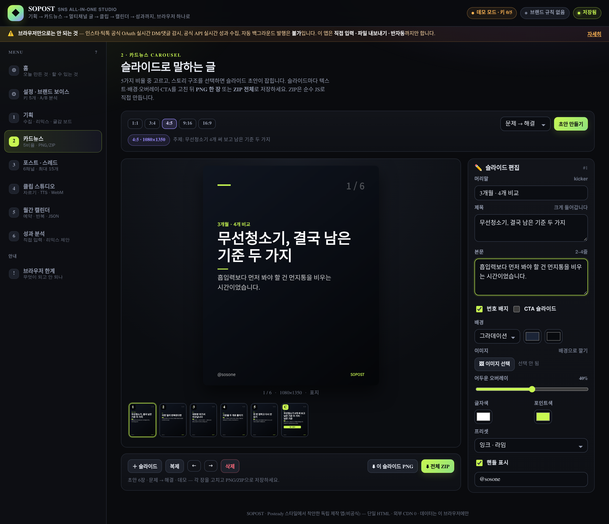
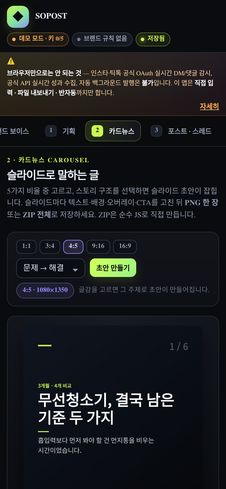

# ◆ SOPOST — Posteady 스타일 SNS 올인원 스튜디오

브랜드 말투 학습부터 **카드뉴스 · 6채널 글 · 스레드 · 클립 · 예약 달력 · 성과 분석**까지, 한 파일에서 끝내는 **단일 HTML 정적 웹앱**입니다.
서버 없음, 설치 없음, 계정 연동 없음. Gemini 키와 작업물은 **이 브라우저(localStorage)에만** 저장됩니다.

> Posteady(`posteady.com`)의 기능 구성에서 착안해 만든 **비공식 독립 제작물**입니다. Posteady와 제휴·제공 관계가 없습니다.

- 파일: `index.html` 하나, 약 235KB (CSS·JS·아이콘 전부 인라인, **외부 CDN/폰트 요청 0건**)
- 화면: 왼쪽 메뉴(홈 · 설정/브랜드 · 1~6단계 · 브라우저 한계) / 가운데 작업판 / 오른쪽 편집 패널, 모바일 390px 단일 열 + 가로 스크롤 메뉴
- 상단 상태: **`데모 모드 · 키 0/5`** ↔ **`AI 연결 · 키 N/5 사용`**, **브랜드 규칙 저장됨 · A/B안**
- 테마: 다크 스튜디오 (라임 · 바이올렛), 한국어 UI





---

## 0. 바로 실행

```bash
# 아무 정적 서버로 열면 됩니다 (권장)
cd posteady-webapp
python3 -m http.server 8000
# → http://localhost:8000/index.html
```

`index.html`을 더블클릭해도 화면과 PNG/ZIP/WebM/JSON은 모두 동작하지만, **Gemini API는 `file://`에서 CORS로 막힐 수 있어** 웹서버(또는 GitHub Pages·Netlify 같은 정적 호스팅)를 권장합니다.
안드로이드 기본 HTML 뷰어는 자바스크립트를 막아 버튼이 동작하지 않습니다 — **Chrome / Samsung Internet**으로 열어 주세요.

---

## 1. 화면 구성

| 위치 | 이름 | 하는 일 |
|---|---|---|
| 홈 | **오늘의 작업판** | 카드뉴스 장수 · 채널 글 수 · 예약 수 · 성과 · 내보낸 파일, 최근 활동 60건, **이 앱이 하는 일/안 하는 일** 요약표 |
| 설정 | **브랜드 보이스** | Gemini 키 **최대 5개**(상태 · **429 자동 전환** · 연결 테스트 · 한도 초기화), 내 글/링크/샘플 **1~5개** 분석 → **A/B** 비교 → 고른 안을 **Brand Rules**(톤·후킹·CTA·금지어·필수 문구)로 저장 |
| 1 | **기획 (Collector & Picker)** | 링크·텍스트·파일 수집(플랫폼 자동 판별), 잘된 글 **리믹스 3/5각도**, 🤖AI 글감 6개 + ✍️내 글감 보드, **RSS·유튜브 수집 설정 JSON** 내보내기 |
| 2 | **카드뉴스** | **5비율**(1:1·3:4·4:5·9:16·16:9), **4가지 스토리 구조**(오류 깨기·문제→해결·비포애프터·체크리스트), 슬라이드별 머리말/제목/본문/배경(그라데이션·단색·내 이미지)/오버레이/CTA/번호 배지/프리셋, **PNG 한 장 · ZIP 전체** 다운로드 |
| 3 | **포스트 · 스레드** | Base 글 → **6채널**(인스타·틱톡·유튜브·스레드·X·블로그) 변환, 채널별 글자 수 제한, **금지어 실시간 검사**, 스레드 **최대 15개**(500자/칸), 첫 댓글, 원클릭 복사(채널/스레드/전체 세트) |
| 4 | **클립 스튜디오** | 영상 여러 개 올려 **구간 자르기 · 최대 5구간 이어붙이기**, **Safe Zone 가이드**(유튜브/인스타/틱톡), 제목·자막 오버레이, **Gemini TTS 5목소리**(Kore·Aoede·Charon·Puck·Fenrir + 문장 간격), **WebM 720×1280** 내보내기 |
| 5 | **월간 캘린더** | 날짜별 예약 추가·수정·삭제, 칩을 **끌어서 다른 날로 이동**, **매주/매월 반복**, **PC 스케줄러용 JSON** |
| 6 | **성과 분석** | 조회·좋아요·댓글·저장 **직접 입력** → 참여율·평균·잘 된 채널/날짜, 채널별 막대 차트, **AI 다음 글감/리믹스 제안** |
| 안내 | **브라우저 한계** | 되는 것/안 되는 것 표, 데이터가 가는 곳 |

---

## 2. 브랜드 보이스 → Brand Rules 흐름

1. **⚙️ 설정 · 브랜드 보이스**에서 내 글 1~5개를 넣습니다(종류: 내 글 / 링크 / 샘플 파일).
   - 링크만 넣으면 주소에서 주제를 추정합니다. 정확도를 높이려면 **본문도 함께** 붙여넣으세요 — 앱이 다른 사이트를 대신 열어 읽으면 외부 요청이 생기므로, 이 앱은 **직접 붙여넣은 글만** 분석합니다.
2. `✨ 브랜드 보이스 A/B 만들기` → 두 가지 안이 나옵니다.
   - **A · 정리형**: 사실·숫자 중심, 짧은 문장
   - **B · 대화형**: 질문·공감 중심, 구어체
3. 마음에 드는 쪽의 `이 안 선택` → **Brand Rules에 자동 저장**(톤·후킹·CTA·금지어·필수 문구).
4. 규칙은 손으로 고칠 수 있습니다. 금지어/필수 문구는 칩으로 추가·삭제(Enter로도 추가), `규칙 저장`을 누르면 카드뉴스·포스트·성과 추천에 즉시 반영됩니다.
5. 저장된 **금지어는 포스트 편집기에서 입력하는 즉시** 검사됩니다(빨간 칩 + 상단 경고).

Gemini 키가 없으면 **데모 분석**이 같은 구조의 규칙을 만들어 줍니다(샘플 문장 패턴에서 추정). 결과물의 형식과 화면은 동일합니다.

---

## 3. Gemini 키와 429 자동 전환

1. <https://aistudio.google.com/apikey> → Google 로그인 → **API 키 만들기** (카드 등록 없음)
2. 앱의 **⚙️ 설정 · 브랜드 보이스** → 키 칸에 붙여넣고 `저장` (최대 5개, 계정마다 하나씩)
3. `연결 테스트`로 확인. 한도가 찬 키(**HTTP 429 / 401 / 403**)는 **‘한도초과’로 표시되고 다음 키로 자동 전환**됩니다. 이미 소진된 키는 다시 호출하지 않습니다.
4. 5개가 모두 막히면 **데모 모드**로 이어집니다. `한도 초과 초기화`로 상태만 되돌릴 수 있습니다(다음 날 다시 시도).

| 쓰는 곳 | 모델 |
|---|---|
| 문구·분석·제안 | `gemini-2.5-flash` (없으면 `gemini-2.0-flash`로 자동) |
| 음성 | `gemini-2.5-flash-preview-tts` (`voiceName`: Kore·Aoede·Charon·Puck·Fenrir) |

> 음성은 문장 단위로 요청하고, 문장 사이 간격(0 / 0.15 / 0.3 / 0.5초)은 **오디오를 다시 만들지 않고 타임라인만 다시 계산**합니다. 키가 없거나 TTS가 실패하면 브라우저 합성음(포만트 합성)으로 **같은 길이의 오디오**를 만들어 WebM에 그대로 넣습니다.

---

## 4. 결과물

| 결과물 | 어디서 | 형식 / 실측 |
|---|---|---|
| 카드뉴스 PNG | 2 카드뉴스 → `이 슬라이드 PNG` | 현재 비율 그대로 (예: 1080×1350), 파일명 `sopost-card-01-4x5.png` |
| 카드뉴스 ZIP | 2 카드뉴스 → `전체 ZIP` | `sopost-01-cover.png … sopost-NN.png` + `deck.json`. **순수 JS ZIP 빌더**(stored, CRC32, UTF-8 파일명 플래그) |
| 클립 WebM | 4 클립 → `WebM 내보내기` | 720×1280, VP9/Opus(미지원 시 VP8), 음성 포함, `sopost-clip-YYYYMMDD.webm` |
| 수집기 설정 | 1 기획 → `수집 설정 JSON` | `sopost-collector.json` — RSS·유튜브·키워드·하루 최대·중복 제거 규칙 |
| 스케줄 | 5 캘린더 → `스케줄 JSON` | `sopost-schedule-YYYY-MM.json` — 이벤트 + 반복 펼친 occurrences + PC 명령 |

### 내보내는 JSON 구조

```jsonc
// sopost-collector.json (PC 수집기용)
{
  "app": "SOPOST collector", "version": 1, "timezone": "Asia/Seoul",
  "rss": { "feeds": ["..."], "maxPerDay": 5 },
  "youtube": { "channels": ["@handle"], "mode": "channel-feed" },
  "keywords": ["무선청소기"],
  "dedupe": { "by": ["url", "title"], "windowDays": 30 },
  "handoff": { "command": "sopost-collector --config sopost-collector.json" },
  "limits": { "note": "브라우저는 주기 수집을 할 수 없습니다..." }
}
```

```jsonc
// sopost-schedule-2026-11.json (PC 스케줄러용)
{
  "app": "SOPOST schedule", "version": 1, "timezone": "Asia/Seoul",
  "month": "2026-11",
  "events": [{ "id": "...", "title": "무선청소기 카드뉴스", "platform": "ig",
               "start": "2026-11-26T19:00:00+09:00", "repeat": "none", "note": "..." }],
  "occurrences": [{ "eventId": "...", "date": "2026-11-26", "time": "19:00", "start": "2026-11-26T19:00:00+09:00" }],
  "handoff": { "command": "sopost-scheduler --file sopost-schedule-2026-11.json" }
}
```

---

## 5. 브라우저에서 **되는 것 / 안 되는 것** (정직하게)

앱 상단 배너와 `브라우저 한계` 화면에 같은 내용을 표로 표시합니다.

| 하고 싶은 일 | 이 앱 | 이유 / 대안 |
|---|---|---|
| 브랜드 말투 학습(A/B) | ✅ 가능 | 붙여넣은 샘플 1~5개 분석 |
| 카드뉴스 PNG·ZIP | ✅ 가능 | Canvas + 자체 ZIP 빌더 |
| 6채널 문구 · 스레드 15 | ✅ 가능 | 제한 길이 자동 축약 |
| 영상 자르기 · 5구간 · WebM | ✅ 가능 | Canvas + MediaRecorder |
| Gemini TTS 5종 | ✅ 가능 | 키 필요, 없으면 합성음 |
| 예약 · 반복 · JSON | ✅ 가능 | 이 기기 저장 + PC 인계 |
| 조회·좋아요·댓글·저장 수집 | 🟡 직접 입력 | 공식 API 실시간 조회는 앱 자격·서버 필요 |
| 예약 시각 자동 게시 | 🟡 PC 스케줄러 | 탭이 닫히면 브라우저는 아무것도 못 함 |
| 인스타·틱톡 공식 OAuth 연동 | ❌ 불가 | 비즈니스 계정·앱 심사·서버 콜백 필요 |
| DM·댓글 실시간 감시 | ❌ 불가 | 웹훅 수신 서버 필요 |
| 다른 계정 자동 로그인·대리 게시 | ❌ 불가 | 약관 위반·계정 정지 위험. 앱은 ‘복사’까지만 |
| 실시간 성과 스크래핑 | ❌ 불가 | CORS·로그인·차단 정책 |

**데이터가 가는 곳**: Gemini API 한 곳(Gemini 키가 있을 때)뿐입니다. 폰트·이미지·분석 도구를 부르지 않고, 영상·이미지는 서버로 올라가지 않습니다.

---

## 6. 검증

```bash
cd posteady-webapp
python3 test/run_tests.py          # 전체 (약 3분)
python3 test/run_tests.py 5        # 특정 섹션만
```

`test/run_tests.py`는 headless Chromium(Playwright)으로 **159개 검사**를 수행합니다. 최근 결과: **159개 검사 · 실패 0개** (`test/last_run.log`).

| 섹션 | 확인 |
|---|---|
| 0 | 단일 HTML, 외부 리소스 참조 0건, `build/`+`build.py` 존재 |
| 1 | 초기 로드, 콘솔 오류 0, **키 없이 외부 요청 0건**, 데모 표기 |
| 2 | 키 5칸, 저장/테스트, **429 → 다음 키 자동 전환**(요청 키 순서 검증), 전부 소진 시 데모 폴백, 새로고침 유지 |
| 3 | 샘플 1~5 A/B, 금지어 칩, 선택 → Brand Rules 저장, 톤 반영 |
| 4 | 링크 3 · 텍스트 · 파일 수집, 리믹스 5, AI 글감 6, 글감 이동, **수집기 JSON 파싱** |
| 5 | 5비율 캔버스 실측(1080×1080 … 1920×1080), 4구조 초안+CTA, 편집 반영, **PNG 1080×1350**, **ZIP `testzip()` CRC 통과**, deck.json |
| 6 | 6채널 생성·길이 제한(스레드 500/X 280), **금지어 실시간**, 클립보드 복사, **스레드 15개 상한·비활성**, 첫 댓글 필수 문구 |
| 7 | 영상 2개 로드·길이 인식, 구간 2개·합계, 5개 상한, Safe Zone/오버레이 캔버스 반영, **TTS 3문장·간격 0.3초 실측**, **WebM 720×1280 실측**, 메모리 전용 안내 |
| 8 | 월 그리드, 추가/수정, **드래그 이동**, 주간 반복 4회 펼침, 스케줄 JSON(+09:00) |
| 9 | 참여율 계산(7.00% / 1.30%), 평균 카드, 차트, **Gemini 제안 3개**, 예시 채우기 |
| 10 | 1440·1024·**390px** 9개 화면 **가로 오버플로 0** |
| 11 | 새로고침 후 키·브랜드·카드뉴스·스레드·캘린더·성과 유지 |

테스트는 Gemini를 **가짜 응답으로 대체**(429·JSON·TTS PCM)해 실제 키 없이 전 경로를 검증합니다. 데모 모드 경로도 별도로 검사합니다.

---

## 7. 파일 구조

```
posteady-webapp/
  index.html               ← 빌드 결과 (이 파일 하나로 실행)
  build/
    build.py               ← build/{body.html,style.css,js/*.js} → index.html
    body.html              ← 화면 골격 (9개 패널)
    style.css              ← 다크 스튜디오 테마 · 모바일 대응
    js/00-core.js          ← 유틸 · 상태 · 저장 · ZIP 빌더
    js/10-brand.js         ← 키 5개 · 429 전환 · 브랜드 A/B · 규칙
    js/20-collect.js       ← 수집 · 리믹스 · 글감 보드 · 수집기 JSON
    js/30-carousel.js      ← 카드뉴스 렌더 · 초안 · PNG/ZIP
    js/40-post.js          ← 6채널 · 스레드 · 금지어 · 복사
    js/50-clip.js          ← 구간 · Safe Zone · TTS · WebM
    js/60-calendar.js      ← 월간 달력 · 반복 · 스케줄 JSON
    js/70-analytics.js     ← 성과 집계 · 차트 · 제안 · 홈
    js/80-boot.js          ← 상태 복원 · 초기화
  test/run_tests.py        ← 종합 자동 테스트
  test/preview.py          ← 미리보기 이미지 생성
  test/last_run.log        ← 최근 테스트 로그 (159/159)
  preview-sopost.png
  preview-sopost-mobile.png
  README.md
```

빌드는 다음 한 줄입니다.

```bash
python3 build/build.py
# wrote .../index.html 234,941 chars (css 30,135 + body 42,373 + js 161,693, js 9 files)
```

---

## 8. 배포

`index.html` 하나면 되므로 **GitHub Pages · Netlify · Cloudflare Pages** 어디든 올릴 수 있습니다.
`/workspace/sopost-deploy.zip`에 배포에 필요한 파일(index.html·README·미리보기·build·test)이 들어 있습니다.

```bash
# 새 저장소를 만든 뒤 (아직 만들지 않았습니다)
gh repo create <이름> --public --source=. --remote=origin --push
```

> 이 작업에서는 GitHub 저장소를 만들지 않았으므로 **푸시하지 않았습니다.** 저장소가 생기면 위 명령 또는 Pages 설정으로 바로 배포할 수 있습니다.

---

## 9. 알아 둘 제약

- **영상은 메모리 전용**입니다. 새로고침하면 다시 올려야 합니다(구간·TTS 대본은 유지). 영상 파일을 localStorage에 넣으면 수 MB를 금방 넘기기 때문입니다.
- WebM 내보내기는 **MediaRecorder**가 있는 브라우저(Chrome·Edge·Firefox / Android Chrome)에서 동작합니다. iOS Safari는 `video/webm` 녹화를 지원하지 않을 수 있습니다.
- 브라우저가 디코딩하지 못하는 코덱(예: 일부 HEVC MOV)은 길이를 읽지 못해 안내 후 건너뜁니다.
- 클립보드가 막힌 환경에서는 `document.execCommand('copy')`로 대체하고, 그것도 막히면 직접 선택하도록 안내합니다.
- localStorage를 지우면 작업물도 사라집니다. 중요한 결과물은 PNG/ZIP/WebM/JSON으로 내려받아 두세요.
- 이미지 배경을 여러 장 넣으면 저장 공간(약 5MB)을 넘을 수 있어, 큰 이미지는 저장 시 제외하고 화면에는 남겨 둡니다(새로고침 시 사라짐).

---

SOPOST · Posteady 스타일 SNS 올인원 스튜디오 — 단일 HTML · 외부 CDN 0 · 데이터는 이 브라우저에만
